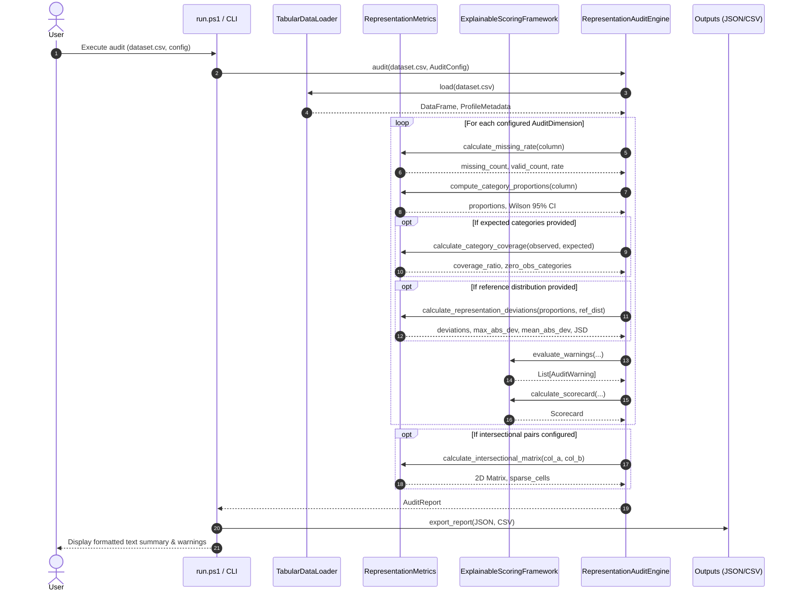

# FairLens System Architecture

This document describes the high-level system architecture, component boundaries, and data flow of **FairLens** across Phases 1 through 4.

---

## 1. System Overview and Two-Layer Design

FairLens is structured into two interconnected layers:

```
+-----------------------------------------------------------------------------------+
|                        FAIRLENS TWO-LAYER ARCHITECTURE                            |
+-----------------------------------------------------------------------------------+
| LAYER A: GENERAL-PURPOSE DATASET REPRESENTATION & DISCOVERY FRAMEWORK             |
|                                                                                   |
|  [User Query] ----> [Component A: Discovery Engine]                               |
|                           | (Multi-source APIs: HF, Zenodo, Data.gov, UCI, Kaggle)|
|                           v                                                       |
|                     [Normalized Metadata & Candidate Datasets]                    |
|                           |                                                       |
|                           v                                                       |
|  [Tabular Data] --> [Component B: Representation-Gap Audit Engine]                |
|                           | (Wilson CI, Category Coverage, JSD, Deviation, Spans) |
|                           v                                                       |
|                     [Structured Audit Report & Warning Registry]                  |
+-----------------------------------------------------------------------------------+
| LAYER B: INDIAN LEGAL & FINANCIAL FAIRNESS CASE STUDY (NEMOTRON 3 ULTRA AUDIT)    |
|                                                                                   |
|  [Seed Statutes & Regulations (IPC/BNS, SEBI/RBI)]                                |
|                           |                                                       |
|                           v                                                       |
|  [Counterfactual Perturbation Suite (Invariant Demographics)]                     |
|                           |                                                       |
|                           v                                                       |
|  [Component D: Cached OpenRouter Client]                                          |
|         (Deterministic SHA-256 Cache, Backoff, Cost Estimator, Budget Gating)     |
|                           |                                                       |
|                           v                                                       |
|  [Model Outcome Flip-Rate Analyzer (Prompt Noise Floor Subtraction)]              |
|                           |                                                       |
|                           v                                                       |
|  [Component E & F: Source-Grounded Corrective Distillation & PEFT Control Run]    |
+-----------------------------------------------------------------------------------+
```

---

## 2. Component Breakdown

### 2.1 Configuration and Logging Layer (`src/fairlens/config`)
- **`Settings` (`settings.py`):** Centralized dataclass loading from environment variables and `.env`. Provides strict type validation and automatic secret masking in string representations.
- **`SecretMaskingFilter` (`logging.py`):** Central logging filter that strips sensitive tokens (e.g. `sk-...`, `gho_...`, `Bearer ...`) from all standard output and log files.

### 2.2 Cached API & Cost Estimation Layer (`src/fairlens/api`)
- **`OpenRouterClient` (`client.py`):** Unified interface for model inference via OpenRouter. Features bounded retries with exponential backoff and jitter, compliance with `Retry-After` headers, and an offline mock mode.
- **`ResponseCache` (`cache.py`):** Deterministic SHA-256 response cache keyed by canonical request payload `(model, messages, temperature, max_tokens)`. Only caches HTTP 200 responses.
- **`CostEstimator` (`pricing.py`):** Pre-execution cost calculator modeling token volumes, cache-hit savings, and safety margins. Blocks queries exceeding configured budget limit (`$5.00`).

### 2.3 Multi-Source Dataset Discovery Engine (`src/fairlens/discovery`)
- **`NormalizedDatasetMetadata` (`schema.py`):** 20+ field standardized schema unifying disparate repositories.
- **Adapters (`adapters/`):** Isolated connectors for Hugging Face Hub, Zenodo, Data.gov CKAN, UCI ML Repository, and Kaggle.
- **`DatasetDiscoveryEngine` (`engine.py`):** Orchestrator executing federated search, URL-based deduplication, metadata completeness ranking, and deterministic offline fixture loading.

### 2.4 Representation-Gap Detection Engine (`src/fairlens/auditing`)
- **`TabularDataLoader` (`loader.py`):** Ingests CSV, Parquet, TSV, and Excel files with duplicate detection, memory profiling, and format validation without modifying original disk files.
- **`RepresentationMetrics` (`metrics.py`):** Calculates missing rates, category proportions, 95% Wilson score confidence intervals, coverage ratios, zero-observation groups, representation deviations, Jensen-Shannon divergence, and 2D intersectional matrices.
- **`ExplainableScoringFramework` (`scoring.py`):** Computes explainable scorecards (Coverage, Parity, Completeness) without artificial reweighting, and triggers rule-based warnings with severity levels.
- **`RepresentationAuditEngine` (`engine.py`):** Generates structured `AuditReport` objects with JSON and CSV export support.

---

## 3. Data Flow Diagram


